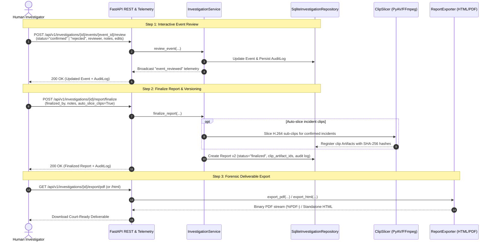

# Phase 5: Human Review & Audit Layer Specification

This document details the architectural design, workflow contracts, domain models, REST/WebSocket interfaces, CLI commands, and export capabilities implemented for **Phase 5 (Human Review & Audit Layer)** of the VIGIL Video Forensics platform.

---

## 1. Architectural Overview & Workflow Integration

Phase 5 completes the end-to-end VIGIL forensic lifecycle specified in [VIGIL_vison_modelContext.txt](file:///D:/Major%20Project/VIGIL/documentation/architectures/VIGIL_vison_modelContext.txt) (Stages 8 & 9: *Report Writer* and *Human Review, Audit, and Report Versions*).



---

## 2. Core Components Implemented

### 2.1 AuditLog Domain Model ([`AuditLog`](file:///D:/Major%20Project/VIGIL/src/vigil/domain/audit.py#L14-L65))
Tracks immutable forensic provenance for all investigator interactions and system modifications:
* **`audit_id`**: Globally unique identifier (e.g. `audit-xxxxxxxx`).
* **`investigation_id`**: Reference to the case.
* **`action`**: Action type (`event_review`, `event_edit`, `report_finalize`, `report_regenerate`).
* **`actor`**: Investigator badge or username.
* **`timestamp`**: Timezone-aware UTC timestamp.
* **`target_type`**: `event`, `report`, `investigation`, or `artifact`.
* **`target_id`**: Target record identifier.
* **`changes`**: Key-value dictionary comparing previous state to new state: `{"status": {"old": "proposed", "new": "confirmed"}}`.
* **`notes`**: Investigator remarks, rationale, or legal justification.

### 2.2 Event Domain Enhancements ([`Event`](file:///D:/Major%20Project/VIGIL/src/vigil/domain/event.py#L11-L93))
* Added `start_seconds` and `end_seconds` with strict non-negative and order validation (`end_seconds >= start_seconds`).
* Added `reviewer`: Username/badge of reviewing investigator.
* Added `review_notes`: Justification or observations recorded during review.
* Added `reviewed_at`: UTC timestamp of review decision.

### 2.3 Report Versioning & Finalization ([`Report`](file:///D:/Major%20Project/VIGIL/src/vigil/domain/report.py#L11-L54))
* **`version`**: Monotonically increasing version counter (`1`, `2`, `3`).
* **`status`**: Lifecycle state (`draft`, `in_review`, `finalized`).
* **`clip_artifact_ids`**: List of verified incident video sub-clips embedded in the report.
* **`notes`**: Concluding investigator remarks.
* **`finalized_at`** & **`finalized_by`**: Chain of custody sign-off metadata.

### 2.4 Persistent SQLite Audit Schema ([`SqliteInvestigationRepository`](file:///D:/Major%20Project/VIGIL/src/vigil/storage/sqlite_repository.py#L127-L139))
```sql
CREATE TABLE IF NOT EXISTS audit_logs (
    audit_id TEXT PRIMARY KEY,
    investigation_id TEXT NOT NULL,
    target_id TEXT NOT NULL,
    target_type TEXT NOT NULL,
    action TEXT NOT NULL,
    actor TEXT NOT NULL,
    timestamp TEXT NOT NULL,
    payload TEXT NOT NULL
);

CREATE INDEX IF NOT EXISTS idx_audit_inv ON audit_logs(investigation_id);
CREATE INDEX IF NOT EXISTS idx_audit_target ON audit_logs(target_id);
```

### 2.5 Report Exporter ([`ReportExporter`](file:///D:/Major%20Project/VIGIL/src/vigil/services/exporter.py#L39-L560))
* **HTML Deliverable (`export_html`)**:
  * Standalone, responsive dark/light forensic interface.
  * Executive summary, case objective, and metrics overview cards.
  * Chronological event timeline with status pills (`CONFIRMED`, `REJECTED`, `PROPOSED`, `UNDER_REVIEW`).
  * Embedded playable HTML5 video players (`<video controls preload="metadata">`) streaming incident sub-clips.
  * Complete evidence assessment table and chronological audit trail table.
  * Clean `@media print` CSS rules for high-contrast paper/PDF printing directly from web browsers.
* **PDF Deliverable (`export_pdf`)**:
  * Generated via ReportLab Platypus engine.
  * Custom two-pass `NumberedCanvas` computing dynamic running headers and footers with total page counts (`Page X of Y`).
  * Structured metadata cards, executive callout boxes, event timeline tables with colored status indicators.
  * Incident clip tables detailing media asset references, intervals, storage paths, and SHA-256 integrity checksums.
  * Complete investigator review decision table and audit trail.

---

## 3. REST API Endpoints Summary

| Method | Endpoint | Description | Status |
|---|---|---|---|
| `POST` | `/api/v1/investigations/{id}/events/{event_id}/review` | Submit human verification (`confirmed`/`rejected`) or status update with rationale | `200 OK` |
| `PATCH` | `/api/v1/investigations/{id}/events/{event_id}` | Directly edit event attributes (description, timestamps, category) with audit tracking | `200 OK` |
| `GET` | `/api/v1/investigations/{id}/events` | List events, with optional filter `?status=confirmed\|rejected\|proposed` | `200 OK` |
| `GET` | `/api/v1/investigations/{id}/events/{event_id}` | Retrieve single event domain record | `200 OK` |
| `POST` | `/api/v1/investigations/{id}/events/{event_id}/clip` | Manually slice a playable sub-clip around an event's time interval | `200 OK` |
| `GET` | `/api/v1/investigations/{id}/audit` | Query audit trail with optional filters (`target_id`, `actor`, `action`) | `200 OK` |
| `POST` | `/api/v1/investigations/{id}/report/finalize` | Finalize report, increment version, slice clips, and update status to `finalized` | `200 OK` |
| `GET` | `/api/v1/investigations/{id}/export/html` | Export interactive HTML forensic report with embedded playable incident clips | `200 OK` |
| `GET` | `/api/v1/investigations/{id}/export/pdf` | Export formal publication-grade PDF deliverable with audit chain of custody | `200 OK` |
| `GET` | `/api/v1/investigations/{id}/report?format=html\|pdf` | Format query support directly on the report endpoint | `200 OK` |
| `GET` | `/api/v1/investigations/{id}/artifacts/{artifact_id}/content` | Stream or download video sub-clips, audio tracks, and JPEG frame artifacts | `200 OK` |

---

## 4. CLI Workflow Commands

The `vigil` CLI script supports all Phase 5 investigator workflows:

```bash
# 1. Start API Server
vigil serve --host 0.0.0.0 --port 8000

# 2. List Events for an Investigation
vigil review list-events inv-001 [--status proposed]

# 3. Review / Confirm an Event
vigil review event inv-001 evt-001 --status confirmed --reviewer "badge-402" --notes "Verified breach on cam 2"

# 4. Review / Reject a False Positive
vigil review event inv-001 evt-002 --status rejected --reviewer "badge-402" --notes "Stray animal trigger"

# 5. Inspect Audit Trail
vigil audit inv-001

# 6. Finalize Report & Slice Incident Clips
vigil finalize-report inv-001 --finalized-by "detective-carter" --notes "Final court submission"

# 7. Export Court-Ready Deliverables
vigil export inv-001 --format html --output report.html
vigil export inv-001 --format pdf --output report.pdf
```

---

## 5. Test Suite Verification

All 197 unit and integration tests are passing with 100% success rate:

```
============================= test session starts =============================
platform win32 -- Python 3.12.13, pytest-9.1.1, pluggy-1.6.0
rootdir: D:\Major Project\VIGIL
configfile: pyproject.toml
plugins: anyio-4.15.1
collected 197 items

tests\unit\agent\test_agent.py ...                                       [  1%]
tests\unit\agent\test_specialized_agents.py ..                           [  2%]
tests\unit\api\test_investigation_service.py ....                        [  4%]
tests\unit\api\test_investigations_endpoints.py ......                   [  7%]
tests\unit\api\test_review_and_export_endpoints.py .....                 [ 10%]
tests\unit\api\test_websocket_telemetry.py ...                           [ 11%]
tests\unit\domain\test_audit_schema.py ......                            [ 14%]
tests\unit\domain\test_evidence_schemas.py ....................          [ 24%]
tests\unit\domain\test_investigation_coverage_report.py ................ [ 32%]
....                                                                     [ 35%]
tests\unit\domain\test_shared_contracts.py ................              [ 43%]
tests\unit\domain\test_source_media_schemas.py .............             [ 49%]
tests\unit\media\test_decoder.py ....                                    [ 51%]
tests\unit\media\test_ingestion.py .                                     [ 52%]
tests\unit\media\test_metadata.py ....                                   [ 54%]
tests\unit\media\test_slicer.py ....                                     [ 56%]
tests\unit\models\test_models.py .....                                   [ 58%]
tests\unit\orchestration\test_executor.py ...........                    [ 64%]
tests\unit\orchestration\test_service.py ..........                      [ 69%]
tests\unit\orchestration\test_task_types.py ....................         [ 79%]
tests\unit\orchestration\test_transitions.py .............               [ 86%]
tests\unit\services\test_report_exporter.py ..                           [ 87%]
tests\unit\services\test_review_workflow.py ...                          [ 88%]
tests\unit\storage\test_audit_repository.py ..                           [ 89%]
tests\unit\storage\test_repository.py ....                               [ 91%]
tests\unit\storage\test_sqlite_repository.py .....                       [ 94%]
tests\unit\test_cli.py ..                                                [ 95%]
tests\unit\tools\test_media_workers.py ....                              [ 97%]
tests\unit\tools\test_tools.py .....                                     [100%]

======================= 197 passed, 1 warning in 24.63s =======================
```
