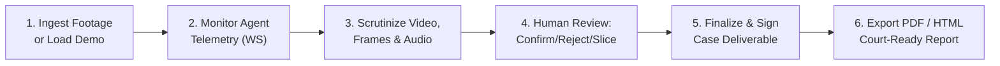

# VIGIL Frontend Operational User Guide & Workflows

## Standard Investigator Workflow

This guide walks through an end-to-end investigation using the VIGIL Mission Control UI.

---

### Step 1: Ingest Video Footage or Seed Demo Case

#### Option A: Seed Demo Case (Recommended for quick testing)
1. Click the **`✨ Demo Case`** button in the top navigation bar, or press <kbd>D</kbd>.
2. VIGIL will generate synthetic surveillance video with night-vision crosshairs and timecodes, extract frames and audio, detect intruder motion and audio transients, correlate events, and index one incident sub-clip.
3. The UI will automatically switch to the newly created demo investigation.

#### Option B: Upload Real Surveillance Footage
1. Click **`+ Ingest Footage`** in the top-right header, or press <kbd>N</kbd>.
2. Drag and drop your `.mp4`, `.mkv`, or `.avi` file onto the drop-zone (or click to browse).
3. Fill in the investigation details:
   - **Case Title**: e.g., `Breach Analysis: South Perimeter Gate`.
   - **Camera ID**: e.g., `cam-south-02`.
   - **Forensic Objective**: e.g., `Identify unauthorized entry into restricted zone between 00:00 and 01:00`.
   - **Sample Interval (s)**: Recommended `1.0s` or `2.0s`.
   - **Max Frames**: e.g., `30` to `50`.
   - **Extract Audio**: Set to `Yes` to demux acoustic tracks.
4. Click **`Launch Autonomous Agents`**. The modal closes and the case will appear in the active dropdown.

---

### Step 2: Live Agent Monitoring

As soon as an investigation is active, the left **Agent Mission Control** panel connects to the WebSocket stream:
- The **WS Indicator** turns green (`WS: CONNECTED`).
- As agents execute, their roster chips light up and pulse in blue glow.
- The **Telemetry Feed** displays real-time updates: frame extraction, visual detections, acoustic speech transcription, and multi-modal correlation.

---

### Step 3: Video Playback & Frame Scrutiny

In the center **Media Station**:
- Use the **Playback Toolbar** to review footage:
  - Press <kbd>Space</kbd> to Play / Pause.
  - Use <kbd>&larr;</kbd> / <kbd>&rarr;</kbd> to seek +/- 2 seconds.
  - Use <kbd>J</kbd> / <kbd>L</kbd> for frame-by-frame scrutiny (+/- 0.1s).
  - Adjust playback speed to `0.5x` or `0.25x` for fine motion analysis.
- Inspect the **Interactive Timeline**:
  - Yellow/Amber markers indicate proposed events requiring review.
  - Emerald markers indicate confirmed events.
  - Hover over any marker to see the timecode and event summary.
  - Click on any marker to jump the playhead to that exact moment.
- Inspect the **Extracted Frames Gallery** in the bottom drawer:
  - Click any frame thumbnail to seek the video player to that frame.

---

### Step 4: Human Review & Incident Clip Slicing

In the right **Human Review Station**:
1. Review the proposed events generated by the temporal correlation agent.
2. For each event:
   - Click **`✔ Confirm`** to mark the event as verified. A review modal will open where you can verify the time interval, enter your investigator badge ID, and record rationale notes.
   - Click **`✖ Reject`** if the event is a false positive (e.g. animal or camera glare).
   - Click **`✎ Edit`** to adjust start/end seconds or refine the category.
   - Click **`▶ Seek`** to preview the event in the video player.
   - Click **`✂ Cut Clip`** to immediately extract a standalone, reviewable H.264 video sub-clip with 1.0-second temporal padding.
3. Switch to the **Incident Sub-clips** tab in the center media panel to play back sliced incident clips.

---

### Step 5: Finalize & Sign Case Deliverable

Once all events are reviewed:
1. Click **`Export Deliverable ▾`** in the top-right header and select **`🔒 Finalize & Sign Case`**.
2. Enter:
   - **Lead Investigator Name / Badge**: e.g., `Chief Det. Vance`.
   - **Deliverable Title**: e.g., `Final Forensic Examination Report`.
   - **Chain of Custody Remarks**: Note evidence integrity and verification findings.
   - **Auto-slice clips**: Check this box to guarantee all confirmed events have sliced sub-clips embedded in the deliverable.
3. Click **`Finalize & Lock Deliverable`**.
4. The report status transitions to `FINALIZED`, a new version number is minted, and an immutable entry is added to the audit trail.

---

### Step 6: Export Deliverable

From the **`Export Deliverable ▾`** menu:
- **Download PDF Report**: Generates a publication-ready PDF containing case metadata, event tables, uncertainty assessments, and audit logs.
- **Open HTML Report**: Opens a self-contained interactive forensic HTML document with embedded video players for all sliced incident clips.
- **View Markdown Summary**: Displays a lightweight Markdown report suitable for case management records.

---

## Keyboard Shortcuts Reference

| Key | Action | Context |
|---|---|---|
| <kbd>Space</kbd> | Play / Pause footage | Video Player |
| <kbd>&larr;</kbd> / <kbd>&rarr;</kbd> | Seek -2.0s / +2.0s | Video Player |
| <kbd>J</kbd> / <kbd>L</kbd> | Frame step -0.1s / +0.1s | Video Player |
| <kbd>X</kbd> | Quick Cut Clip around playhead | Video Player |
| <kbd>F</kbd> | Toggle Fullscreen | Video Player |
| <kbd>D</kbd> | Seed & Load Demo Case | Global |
| <kbd>N</kbd> | Open Ingestion Modal | Global |
| <kbd>E</kbd> | Toggle Export Menu | Global |
| <kbd>?</kbd> | Show Keyboard Shortcuts Cheat Sheet | Global |
| <kbd>Esc</kbd> | Close any open modal or menu | Global |
